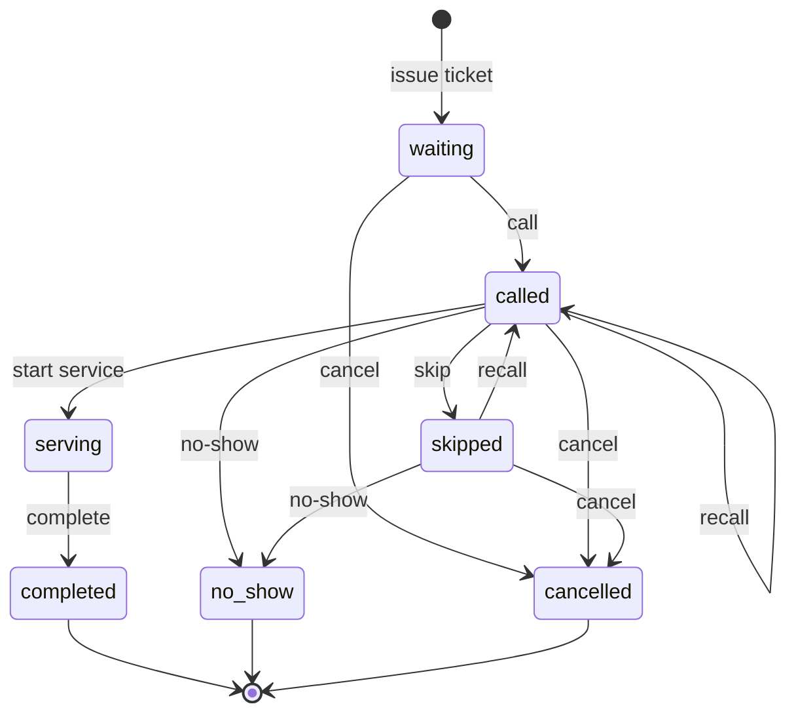

<div align="center">

# 🦷 DENTRA

**A multi-tenant SaaS for dental clinic management.**
Patients, appointments, live queue, doctors and a service catalogue, in one clean dashboard.


</div>

<!--
  Add a screenshot of the dashboard here once the repo is public:
  
-->

---

## Table of contents

- [About](#about)
- [Features](#features)
- [Tech stack](#tech-stack)
- [Getting started](#getting-started)
- [Demo account](#demo-account)
- [Architecture](#architecture)
- [Queue module](#queue-module)
- [Roles and permissions](#roles-and-permissions)
- [Project structure](#project-structure)
- [Useful commands](#useful-commands)
- [Troubleshooting](#troubleshooting)
- [Roadmap](#roadmap)
- [Contributing](#contributing)
- [License](#license)

---

## About

DENTRA helps dental clinics run their day: registering patients, booking appointments with the right doctor and treatment, checking patients in, and calling them from a live queue. Every clinic (tenant) works in its own isolated space, and staff only see what their role allows.

The project is built in small, testable steps. Each module is designed to work on its own and to plug into the next one (appointment → check-in → queue → visit).

## Features

### Available now

| Module | What it does |
|---|---|
| **Dashboard** | Live numbers for today: patient visits, new vs. returning patients, today's queue, live queue status, upcoming appointments, a month calendar with appointment markers, and automatic reminders (for example "3 patients waiting"). |
| **Patients** | Patient registry with search, patient numbers and status. |
| **Doctors** | Doctor profiles with specialization and branch assignment. |
| **Appointments** | Booking with patient, branch, **doctor** and **service**. The end time is filled from the service duration. Doctors and patients cannot be double-booked, and the check is race-safe. |
| **Check-in** | One click turns today's appointment into a queue ticket and marks it as `checked_in`. Completing, cancelling or no-showing the ticket keeps the appointment in sync. |
| **Queue** | Tickets such as `A-001`, per branch and per day. Call next, recall, skip, no-show, cancel, priority and emergency tickets, one patient in service per doctor, and a full activity history for every ticket. |
| **Services** | Service catalogue with code, category, default duration and price. Services that have been used are deactivated instead of deleted, so history stays intact. |
| **Dental records** | Basic dental record entries per patient. |
| **Access control** | Role and permission based access, enforced on the server and reflected in the UI (menus, buttons, dashboard panels). |

### Planned

Visits and clinical notes, odontogram (tooth chart), treatment plans, prescriptions, billing and payments, inventory, patient portal, subscription plans and a platform admin area. See the [roadmap](#roadmap).

## Tech stack

- **Backend:** Laravel 12, PHP 8.2+
- **Database:** MySQL 8 (MariaDB 10.6+ also works)
- **Frontend:** Blade, Tailwind CSS 3.4, Alpine.js, Vite 7
- **Auth:** session based authentication with email verification (Laravel Breeze style)

## Getting started

### Requirements

- PHP 8.2 or newer with the usual Laravel extensions (`mbstring`, `openssl`, `pdo_mysql`, `ctype`, `json`, `tokenizer`, `xml`, `fileinfo`)
- Composer 2
- Node.js 20.19+ and npm
- MySQL 8 or MariaDB 10.6+ (XAMPP works fine)

### Installation

```bash
# 1. Clone the repository
git clone https://github.com/<your-username>/dentra.git
cd dentra

# 2. Install dependencies
composer install
npm install

# 3. Create your environment file and app key
cp .env.example .env          # on Windows PowerShell: Copy-Item .env.example .env
php artisan key:generate
```

Create an empty database (for example `dentra`) and set it in `.env`:

```dotenv
DB_CONNECTION=mysql
DB_HOST=127.0.0.1
DB_PORT=3306
DB_DATABASE=dentra
DB_USERNAME=root
DB_PASSWORD=
```

Then run the migrations and seeders, and start the app:

```bash
# 4. Create the tables and load roles, permissions and a demo clinic
php artisan migrate --seed

# 5. Run the app (two terminals)
php artisan serve
npm run dev
```

Open <http://127.0.0.1:8000> and log in with the [demo account](#demo-account).

> **Important:** run `php artisan migrate` **before** seeding. The seeders expect the tables to exist.

### Production build

```bash
npm run build
php artisan config:cache
php artisan route:cache
php artisan view:cache
```

## Demo account

`DentraDemoSeeder` creates a demo clinic called **Smile Dental Clinic** with a main branch and an owner account:

| | |
|---|---|
| Email | `admin@dentra.test` |
| Password | `password` |

> ⚠️ These credentials are for local development only. Never seed the demo account on a production server, and change the password if you do.

## Architecture

### Multi-tenancy

DENTRA uses a **single database** with a `tenant_id` column on every clinic-owned table.

- A user can belong to one or more clinics through the `tenant_user` pivot table, which also stores the user's **role** and an `is_active` flag.
- The `active.tenant` middleware reads the active clinic from the session, verifies that the user really belongs to it, and stores it in `TenantContext`.
- Controllers take the tenant from `TenantContext` and never trust a `tenant_id` from a request. Every query is scoped with `where('tenant_id', ...)`, and records of another clinic return `404`.
- Business rules live in service classes (`App\Services\...`), not in controllers.

### Access control

- Permissions are slugs such as `appointments.view` or `queues.update`, grouped into roles.
- `User::hasPermission()` loads the role and permissions **once per request** and caches them on the user instance.
- In Blade, use the `@canDent('slug')` directive. On the server, controllers call `abort_unless($user->hasPermission('slug', $tenant), 403)`.

### Data integrity

- Queue numbers and appointment bookings use database transactions and row locks, so two receptionists acting at the same moment cannot create duplicates or double bookings.
- Queue activity is stored in an **append-only** `queue_events` table. The model refuses updates and deletes.
- Deleting is avoided where history matters: used services are deactivated, and appointments that are checked in cannot be edited or deleted until their ticket is closed.

## Queue module

Each ticket follows a strict state machine. Only valid actions are shown as buttons, and the server rejects everything else.



Rules worth knowing:

- **Numbering:** `A-001`, `A-002`, ... per branch and per day. Soft-deleted rows still count, so a number is never reused.
- **Call next order:** emergency, then priority, then normal. First come first served inside the same priority.
- **One patient in service per doctor.**
- **Priority and emergency tickets** require the `queues.update` permission.
- **Appointment sync:** completing a ticket completes its appointment, a no-show marks the appointment as no-show, and cancelling the ticket restores the appointment to its previous status so the patient can be checked in again.
- **Audit trail:** every action records who did it, when, the status before and after, and an optional reason. The ticket detail page shows the full history.

## Roles and permissions

Roles are created by `DentraRbacSeeder`. Re-run it after pulling updates that add new permissions.

| Role | Purpose |
|---|---|
| `super_admin` | Full platform access |
| `owner` | Full clinic access |
| `clinic_admin` | Administration, billing, inventory, staff |
| `receptionist` | Patients, appointments, queue |
| `dentist` | Clinical work, own appointments and queue |
| `assistant` | Read access to clinical data |
| `finance` | Billing, payments, reports |
| `patient` | Patient portal (planned) |

```bash
php artisan db:seed --class=DentraRbacSeeder
```

> The seeder re-syncs the permissions of every role. If you customise roles in the database, export your changes before re-running it.

## Project structure

```text
app/
├── Exceptions/QueueException.php     # user-facing business rule errors
├── Http/
│   ├── Controllers/Clinic/           # Dashboard, Patient, Doctor, Appointment, Queue, Service, DentalRecord
│   └── Middleware/                   # SetActiveTenant, CheckPermission
├── Models/                           # Tenant, User, Role, Permission, Patient, Doctor,
│                                     # Appointment, Queue, QueueEvent, Service, ...
├── Services/Queue/QueueService.php   # ticket numbering, state machine, audit, check-in
└── Support/TenantContext.php         # the active clinic for the current request
database/
├── migrations/
└── seeders/                          # DentraRbacSeeder, DentraDemoSeeder
resources/views/
├── layouts/                          # app layout and sidebar
└── clinic/                           # dashboard, patients, doctors, appointments, queues, services
routes/web.php
```

## Useful commands

```bash
php artisan migrate                              # apply new migrations
php artisan migrate:fresh --seed                 # rebuild everything with demo data (destroys data!)
php artisan db:seed --class=DentraRbacSeeder     # refresh roles and permissions
php artisan route:list --path=clinic             # list clinic routes
php artisan optimize:clear                       # clear config, route, view and cache
```

## Troubleshooting

**`Base table or view not found` (for example `dentra.services`)**
A migration has not been run. Run `php artisan migrate`.

**A menu item is missing from the sidebar**
Menu items are shown by permission. Run `php artisan db:seed --class=DentraRbacSeeder`, then log out and log in again.

**403 on a page you expect to open**
Your role does not have the required permission. Check the role mapping in `DentraRbacSeeder`.

**`npm run dev` shows a blank or unstyled page**
Make sure Vite is running. If `public/hot` exists but Vite is not running, delete that file.

**Changes to views or routes are not showing**
Run `php artisan optimize:clear`.

## Roadmap

- [x] Multi-tenant foundation, roles and permissions
- [x] Patients and doctors
- [x] Appointments with doctor and service, conflict detection
- [x] Queue with audit trail and appointment check-in
- [x] Live dashboard
- [x] Service catalogue
- [ ] Visits and clinical notes, started from a ticket in service
- [ ] Odontogram (tooth chart) and treatment plans
- [ ] Prescriptions
- [ ] Billing, invoices and payments (using the service catalogue)
- [ ] Inventory and suppliers
- [ ] Global tenant scope and automated feature tests for tenant isolation
- [ ] Patient portal
- [ ] Subscription plans and platform admin area
- [ ] Reports

## Contributing

Contributions are welcome while the project is taking shape.

1. Fork the repository and create a branch: `git checkout -b feature/short-description`
2. Keep changes focused. One module or one fix per pull request.
3. Put business rules in a service class, scope every query by tenant, and check permissions in the controller.
4. Open a pull request and describe what changed and how you tested it.

Please do not commit `.env`, `database/*.sqlite`, `public/hot`, `vendor/` or `node_modules/`.

## License

Choose a license before publishing. Until then all rights are reserved by the author.
If you want an open license, add a `LICENSE` file (for example MIT) and update this section.
